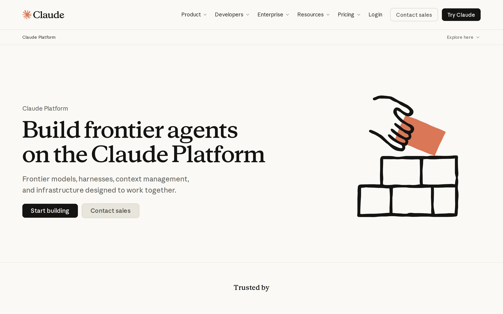

# Anthropic Claude Platform signed-out page: first-impression craft

## Evaluation summary

Baseline craft assessment for the Claude Platform /platform/api signed-out landing. The page makes a confident first impression through a bold typographic hero, obvious primary CTA, and a consistent visual system. The hero headline and primary button are immediately legible on desktop and mobile, and subsequent sections are organized into modular feature, trust, and pricing blocks that scale across breakpoints. Evidence: large serif headline "Build frontier agents on the Claude Platform," two clear CTAs (Start building, Contact sales), right-side illustration, feature cards (security, residency, data), model pricing tiles, and trust logos visible in the captured screenshots and HTML.

Patterns worth borrowing
- Big, unambiguous hero headline paired with a single, high-contrast primary CTA that reads well on mobile and desktop. This makes the primary message discoverable within three seconds.  
- Consistent visual system: a restrained color palette, repeating illustration style, and unified button treatments that make different sections feel like one product.  
- Modular sections and cards for features, safeguards, and trust signals that can be reordered without breaking the layout.

Anti-patterns to avoid
- Dense navigational dropdowns and many top-level links that can overwhelm a cold visitor; consider surfacing fewer options or a focused developer path for this page.  
- Large blocks of marketing testimonials and duplicated promotional copy can compete with the hero signal if not visually scoped; keep below-the-fold social proof concise so it does not dilute the initial promise.  
- Repeating detailed pricing tiles near the hero could distract from the primary action for visitors who need a simpler entry point.

## Evidence

- Target URL: https://claude.com/platform/api
- Canonical URL: https://claude.com/platform/api
- [Page text](screenshots/2026-W43_anthropic-claude-platform-signed-out-page-first-impression-craft_39661530259_1/page-text.txt)
- [HTML snapshot](screenshots/2026-W43_anthropic-claude-platform-signed-out-page-first-impression-craft_39661530259_1/page-content.html)

*Desktop viewport: above the fold.*

*Desktop viewport: full page.*

*Desktop viewport: mid-page.*

*Mobile viewport.*

## Craft review

This report establishes the comparable craft baseline once for this canonical page, capture context, and rubric.

This baseline establishes the page's craft at the time of capture. The design reads as a single, intentional system: a strong serif headline anchors the left column, a clear black primary CTA provides immediate action, and illustrative and iconographic elements support the message without competing visually. The site uses modular sections for features, compliance, and models which improves scalability and resilience across content changes. Evidence used: the above-the-fold screenshot showing the hero headline and CTAs, the mid-page and full-page screenshots showing feature cards and compliance logos, and the HTML snapshot with headings, CTA labels, and model pricing tiles.

| Dimension | Weight | Score | Weighted score | Rationale |
|---|---:|---:|---:|---|
| Visual hierarchy | 1x | 5 | 5 | The hero establishes a clear primary message and action: a very large serif headline ('Build frontier agents on the Claude Platform') and a high-contrast 'Start building' button are visually dominant on desktop and stack sensibly on mobile, making intent discoverable within three seconds. |
| Information density | 1x | 4 | 4 | The hero and feature cards use ample white space so every element mostly earns its place, but the page includes many downstream details (model pricing tiles, long testimonial blocks, large nav dropdowns) that increase density and could be trimmed for an even cleaner first impression. |
| Readability | 1x | 5 | 5 | Typography and contrast support fast scanning: the serif headline is large and readable, body copy uses comfortable sizes and line lengths, and CTAs have strong contrast on the light background; the mobile layout preserves legibility with clear stacking of elements. |
| Coherence | 2x | 5 | 10 | The page feels like one designed thing: the color palette, illustration style, iconography, and button treatments are applied consistently across the hero, features, trust badges, and footer, creating a unified visual language. |
| Durability | 1x | 5 | 5 | The layout is modular (hero, feature cards, model tiles, trust logos) and uses responsive rules shown in the mobile screenshot, so the design should hold well if content changes by roughly 30 percent; components are reusable and spacing appears resilient. |
| Intentionality | 1x | 4 | 4 | Most design choices read as deliberate (prominent CTA, illustrative motif, trust signals). A few elements, such as extensive model pricing details near the top and multiple large testimonial blocks, feel more like marketing density than distilled decisions, which reduces perceived intentionality slightly. |
| **Total** |  |  | **33/35** | **Comparable craft baseline.** |

### Human craft review

| Dimension | AI score | Human score | Notes |
|---|---:|---:|---|
| Visual hierarchy | 5/5 |  |  |
| Information density | 4/5 |  |  |
| Readability | 5/5 |  |  |
| Coherence (2x) | 5/5 |  |  |
| Durability | 5/5 |  |  |
| Intentionality | 4/5 |  |  |
| **Total** | **33/35** |  |  |

## Human verdict

Reviewed:

[ ] Confirmed / [ ] Needs revision

Record any scope exclusions explicitly. Confirmation applies only to the supplied human ratings or validation.

*Scoring model: gpt-5-mini*
*Status: auto-scored, pending human review*
