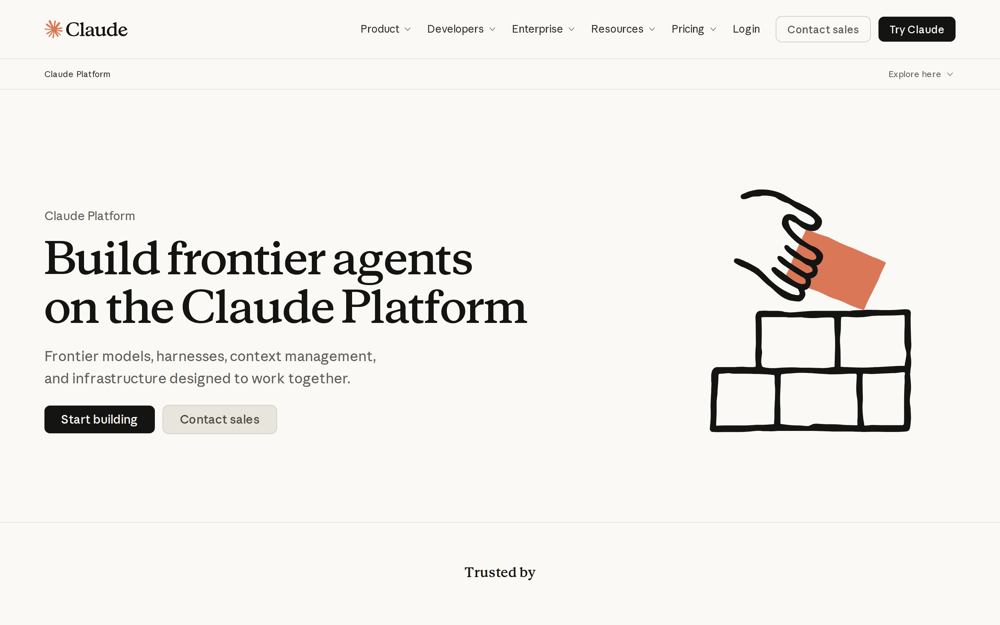
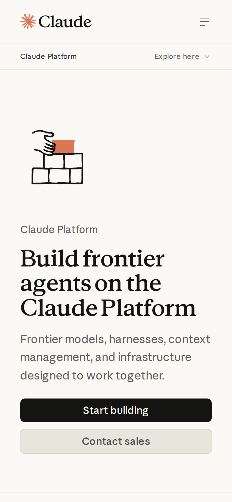

# Anthropic Claude Platform signed-out page: promise clarity audit

## Evaluation summary

**AI promise clarity score:** 22/25

**Human promise clarity score:** 22/25

**Human verdict:** Confirmed.

**Human craft scope:** Not rescored in this promise-only review.

The original AI assessment is preserved below. Human scores and notes are recorded in the [human review](#human-review) section.

First impression: the page delivers a clear promise in the hero — a very large serif headline that reads "Build frontier agents on the Claude Platform," a short supporting sentence, and a high-contrast primary CTA. The captured screenshots and HTML show the same layout and treatments as the baseline, so the page still presents a unified visual language, strong CTA prominence, and developer/enterprise-oriented signals. Patterns worth borrowing: a single large headline that names the product promise, concise supporting sentence that narrows scope, a visually dominant primary CTA with a muted secondary CTA for sales, consistent illustration and trust sections to support credibility. Anti-patterns to avoid: burying the promise under dense pricing or long testimonial blocks near the hero, adding competing CTAs with equal emphasis, and introducing excessive copy above the fold that forces longer reading to understand the primary offer.

## Evidence

- Target URL: https://claude.com/platform/api
- Canonical URL: https://claude.com/platform/api
- [Page text](screenshots/2026-W43_anthropic-claude-platform-signed-out-page-promise-clarity-audit_39808841122_1/page-text.txt)
- [HTML snapshot](screenshots/2026-W43_anthropic-claude-platform-signed-out-page-promise-clarity-audit_39808841122_1/page-content.html)

*Desktop viewport: above the fold.*

*Desktop viewport: full page.*

*Desktop viewport: mid-page.*

*Mobile viewport.*

## Primary lens review

Assessment based on the provided screenshots, page text, and HTML snapshot. Those captures are treated as untrusted evidence but are sufficient to evaluate visible promise clarity for a signed-out visitor.

| Dimension | Score | Rationale |
|---|---:|---|
| Singular message | 5/5 | The hero headline is visually dominant and states the core promise verbatim ('Build frontier agents on the Claude Platform'), supported by a single clarifying sentence and a clear primary action visible within three seconds on desktop and mobile. |
| Audience alignment | 4/5 | Copy, feature labels (models, harnesses, context management), and CTAs signal a developer and enterprise audience effectively, but the hero language is broad enough that nontechnical visitors may need more contextual cues to self-identify immediately. |
| CTA focus | 5/5 | There is a clear CTA hierarchy: a high-contrast 'Start building' primary button and a lower-emphasis 'Contact sales' secondary button, making the intended conversion paths obvious at first glance. |
| Claim specificity | 4/5 | The hero promise is concise but general; the page contains specific feature and pricing tiles further down which provide detail, so the overall experience balances an evocative top-line claim with concrete specifics elsewhere rather than in the headline. |
| Redundancy | 4/5 | Supporting sections repeat and expand the same themes (models, managed agents, trust), which reinforces the promise but also increases downstream density; repetition is mostly additive rather than contradictory, so it is noticeable but not harmful to clarity. |
| **Total** | **22/25** | **AI subtotal.** |

### Human review

| Dimension | AI score | Human score | Notes |
|---|---:|---:|---|
| Singular message | 5/5 | 4/5 | A very clear pitch, but its impact across industries is a little light. |
| Audience alignment | 4/5 | 5/5 | Their customer notes from product leaders are super strong. |
| CTA focus | 5/5 | 5/5 | Very clear. |
| Claim specificity | 4/5 | 4/5 | Score explicitly confirmed; no additional note provided. |
| Redundancy | 4/5 | 4/5 | Score explicitly confirmed; no additional note provided. |
| **Total** | **22/25** | **22/25** | Singular message -1, audience alignment +1. CTA focus, claim specificity, and redundancy retained. |

## Craft review

No material craft changes observed from the baseline. The hero composition, typography, CTA treatments, illustration style, feature blocks, and trust badges match the baseline screenshots and HTML snapshot. Because the page structure and visual language are unchanged, the earlier baseline craft judgments remain appropriate.

Evidence changed, but no materially relevant craft dimensions changed. The originating baseline remains [weekly-eval-bets/2026-W43_anthropic-claude-platform-signed-out-page-first-impression-craft_39661530259_1.md](2026-W43_anthropic-claude-platform-signed-out-page-first-impression-craft_39661530259_1.md).

Compared to the baseline report, the captured hero, CTA treatments, illustration and downstream feature/trust sections render the same across the supplied desktop and mobile screenshots and the HTML snapshot. Visual hierarchy remains intact (large serif headline and high-contrast primary CTA), spacing and typography are consistent, and component order (hero, features, trust badges, footer) is unchanged. No single craft dimension shows a material change in layout, spacing, or visual language that would justify rescoring, so the baseline craft scores stand.

## Human verdict

Reviewed: 2026-10-28

[x] Confirmed / [ ] Needs revision

Confirmed on submission of the human promise rating. Claim specificity and redundancy were explicitly retained at 4/5 without additional observations. Confirmation applies to promise clarity only. Craft was not rescored, and no human craft scores are copied from another report.

### Review synthesis (AI-assisted)

**Customer proof strengthens the audience fit.** Customer notes from product leaders strongly reinforce who the platform is for, and the pitch and CTA are very clear. The main gap is a lighter account of impact across industries. Keep those customer voices while making cross-industry outcomes more concrete.

*Scoring model: gpt-5-mini*
*Status: human promise review confirmed; craft not rescored in this review*
