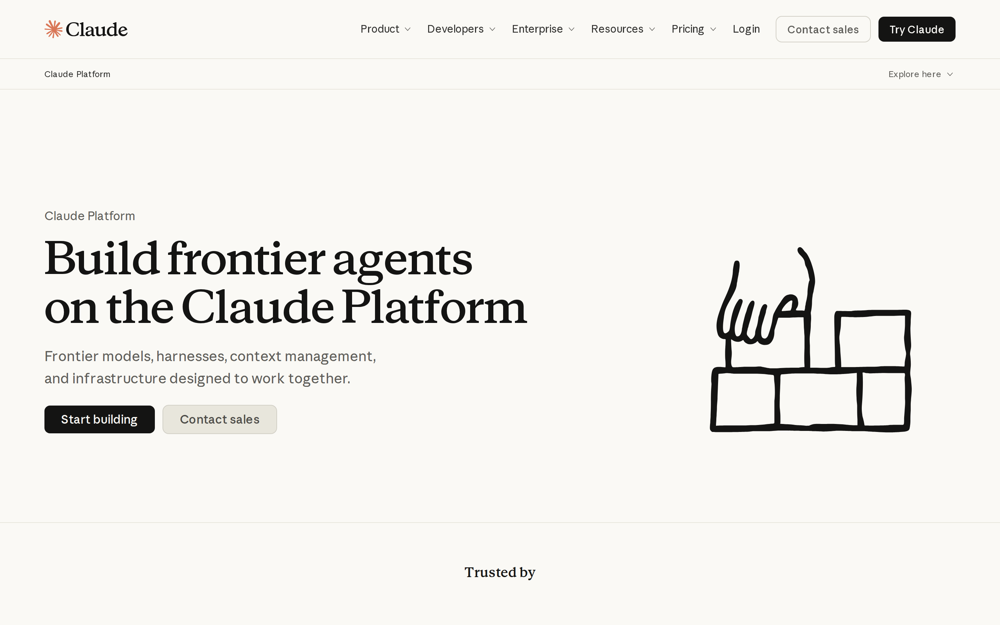
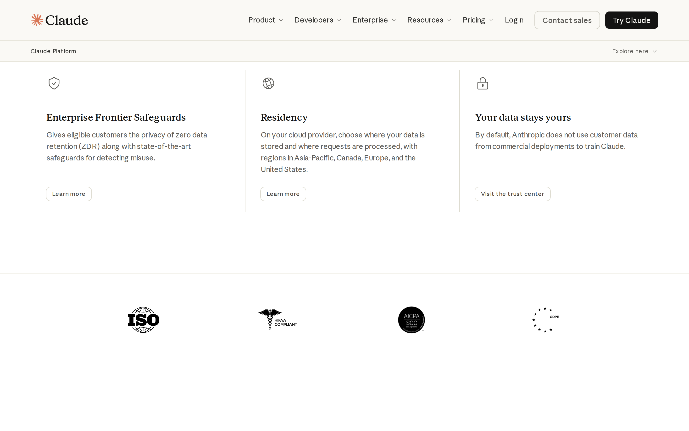

# Anthropic Claude Platform signed-out page: trust architecture

## Evaluation summary

What the capture shows: the signed-out Claude Platform landing preserves the large serif hero headline, concise supporting copy, two primary CTAs (Start building, Contact sales), an illustrative motif, and trust content lower on the page (testimonials, trust badges, security/residency statements). The HTML and screenshots show the same responsive stacking and modular sections visible in the baseline. Patterns worth borrowing: a dominant, readable hero headline that sets the promise quickly; an immediate, high-contrast primary CTA paired with a secondary sales CTA; explicit risk-reduction signals grouped (security, residency, trust center) close enough to product claims to be discoverable; consistent illustration and typographic system that unifies the page. Anti-patterns to avoid: burying detailed model pricing and long testimonial blocks too close to the first fold where they can dilute the promise; adding redundant navigation controls or large dropdown content that increases cognitive load; putting critical trust details only far below the fold so cold visitors must hunt for them.

## Evidence

- Target URL: https://claude.com/platform/api
- Canonical URL: https://claude.com/platform/api
- [Page text](screenshots/2026-W44_anthropic-claude-platform-signed-out-page-trust-architecture_40367610256_1/page-text.txt)
- [HTML snapshot](screenshots/2026-W44_anthropic-claude-platform-signed-out-page-trust-architecture_40367610256_1/page-content.html)

*Desktop viewport: above the fold.*

*Desktop viewport: full page.*

*Desktop viewport: mid-page.*

*Mobile viewport.*

## Primary lens review

| Dimension | Score | Rationale |
|---|---:|---|
| Sequence | 5/5 | The page presents a clear sequence: large promise in the hero, concise supporting benefits, then two CTAs; downstream sections expand on capabilities and trust without interrupting the primary conversion path, so intent is discoverable in the expected order. |
| Specificity | 4/5 | The page balances high-level promise with concrete details later (model names, token pricing, feature tiles), but the hero remains intentionally broad which reduces immediate specificity for cold visitors. |
| Social proof quality | 5/5 | Captured content includes named customer quotes, multiple long-form customer stories, and recognizable trust badges and compliance logos, providing layered, high-quality social proof for enterprise visitors. |
| Friction to first action | 5/5 | Primary CTA is visually prominent and labeled 'Start building'; secondary 'Contact sales' is available; the hero-level actions are obvious and require minimal navigation from the signed-out state, reducing first-action friction. |
| Risk reduction | 5/5 | Security and privacy signals are present and explicit (enterprise safeguards, residency options, statement that customer data is not used to train Claude by default, links to a trust center), which meaningfully reduces perceived technical and data risk for enterprise buyers. |
| **Total** | **24/25** | **AI subtotal.** |

### Human review

| Dimension | AI score | Human score | Notes |
|---|---:|---:|---|
| Sequence | 5/5 |  |  |
| Specificity | 4/5 |  |  |
| Social proof quality | 5/5 |  |  |
| Friction to first action | 5/5 |  |  |
| Risk reduction | 5/5 |  |  |
| **Total** | **24/25** |  |  |

## Craft review

Delta assessment against baseline: no material design-craft changes detected. The current screenshots and HTML show the same hero composition, typographic scale, CTA treatments, illustration style, feature/trust modules, and responsive stacking that formed the baseline. Because the page structure, visual language, and component treatments remain consistent with the baseline evidence, there are no changed craft scores to record.

Evidence changed, but no materially relevant craft dimensions changed. The originating baseline remains [weekly-eval-bets/2026-W43_anthropic-claude-platform-signed-out-page-first-impression-craft_39661530259_1.md](2026-W43_anthropic-claude-platform-signed-out-page-first-impression-craft_39661530259_1.md).

I compared the captured HTML and multiple screenshots (desktop hero, mid-page trust/security tiles, mobile stacking) to the baseline evidence. The hero headline size, serif type, supporting body copy, two-button CTA pattern, illustration placement, card-like feature rows, and the presence of compliance badges and trust statements all match the baseline. That parity indicates no material change to visual hierarchy, information density, readability, coherence, durability, or intentionality since the baseline.

## Human verdict

Reviewed:

[ ] Confirmed / [ ] Needs revision

Record any scope exclusions explicitly. Confirmation applies only to the supplied human ratings or validation.

*Scoring model: gpt-5-mini*
*Status: auto-scored, pending human review*
