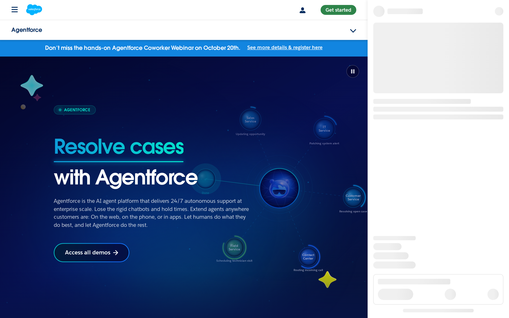
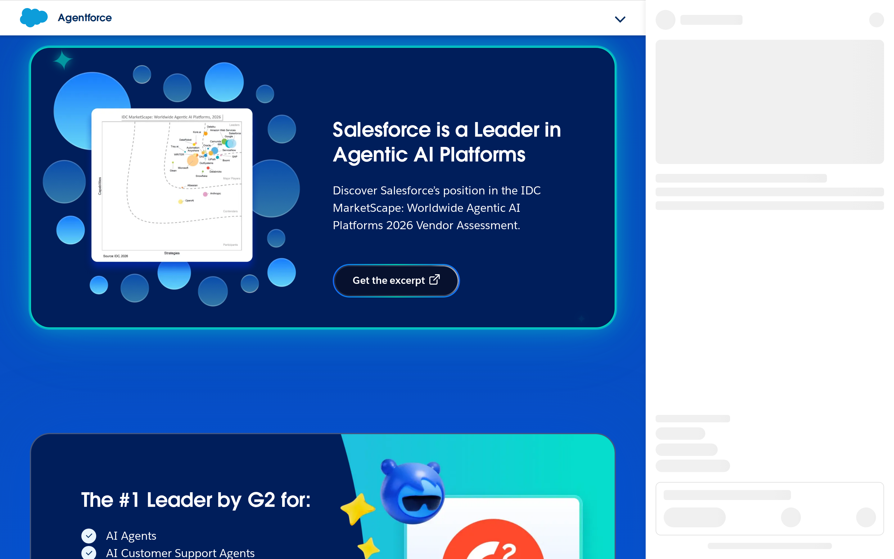
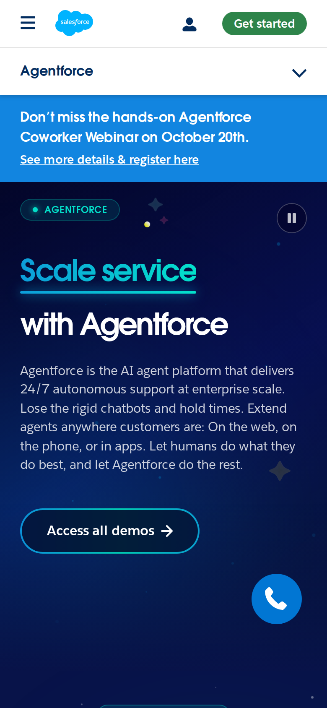

# Salesforce Agentforce signed-out page: first-impression craft

## Evaluation summary

The Agentforce landing page makes a confident first impression through a strong hero treatment, clear primary message, and consistent brand system. The screenshots show a dominant dark-blue hero with a large two-line headline (Resolve cases / with Agentforce or Scale service / with Agentforce depending on view), an immediately visible primary CTA (Access all demos), and a top announcement banner about a webinar. The page uses repeating circular motif graphics and rounded content cards to build a unified visual language. Patterns worth borrowing include a single, highly legible hero headline with a clear protective space and a visible primary CTA; consistent use of color and shape to connect sections; and modular cards for trust and proof that scale across breakpoints. Anti-patterns to avoid are competing top-level banners that compete with the hero for attention, many small secondary CTAs that dilute a primary conversion path, and decorative animations or floating elements that risk obscuring content or meaning on small screens. The captured screenshots and HTML confirm the hero message, the CTA text, the presence of trust elements (G2/IDC references), and the repeated brand motifs; these visual facts drove the craft scores below.

## Evidence

- Target URL: https://www.salesforce.com/agentforce/
- Canonical URL: https://www.salesforce.com/agentforce/
- [Page text](screenshots/2026-W44_salesforce-agentforce-signed-out-page-first-impression-craft_40542275795_1/page-text.txt)
- [HTML snapshot](screenshots/2026-W44_salesforce-agentforce-signed-out-page-first-impression-craft_40542275795_1/page-content.html)

*Desktop viewport: above the fold.*

*Desktop viewport: full page.*

*Desktop viewport: mid-page.*

*Mobile viewport.*

## Craft review

This report establishes the comparable craft baseline once for this canonical page, capture context, and rubric.

Baseline craft: the design communicates the product promise quickly and consistently. The hero delivers a clear message and CTA above the fold, typography and contrast support scanning, and the repeated circular motifs and rounded cards yield a cohesive brand experience. The design is resilient to moderate content changes but could be improved by reducing competing top-level banners and tightening the number of secondary CTAs so the main conversion path is less noisy.

| Dimension | Weight | Score | Weighted score | Rationale |
|---|---:|---:|---:|---|
| Visual hierarchy | 1x | 5 | 5 | The hero headline and primary CTA are visually dominant in the screenshots and render above the fold; a large two-line headline, strong size contrast, and a prominent 'Access all demos' button make the primary message and action obvious within seconds despite a narrow top announcement bar. |
| Information density | 1x | 4 | 4 | The hero area is intentionally sparse and focused, then the page follows with modular cards and sections that group related details; however the presence of many 'Learn more' links, multiple CTAs, and a long scroll of content introduces mild noise that could be trimmed. |
| Readability | 1x | 4 | 4 | Headlines use large, high‑contrast type and body copy is readable against the dark blue gradient in the screenshots; small decorative text and some lighter UI elements may reduce legibility in edge cases but overall scanning is well supported. |
| Coherence | 2x | 5 | 10 | The visual system is consistent across the captured views: shared colors (deep blues and teals), rounded cards, circular motifs, and consistent CTA styling create a unified, intentional page that reads as one designed thing. |
| Durability | 1x | 4 | 4 | The layout uses modular blocks and a strong hero treatment that should absorb content changes (new copy, additional proof points) without breaking the visual structure, though an overabundance of small CTAs or banner messages could destabilize focus if added. |
| Intentionality | 1x | 4 | 4 | Most design choices communicate clear goals: hero to articulate promise, demos CTA to drive product exploration, and trust sections for proof; some decorative floating elements and the persistent announcement strip feel more ornamental or tactical and slightly reduce the sense that every decision is strictly purposeful. |
| **Total** |  |  | **31/35** | **Comparable craft baseline.** |

### Human craft review

| Dimension | AI score | Human score | Notes |
|---|---:|---:|---|
| Visual hierarchy | 5/5 |  |  |
| Information density | 4/5 |  |  |
| Readability | 4/5 |  |  |
| Coherence (2x) | 5/5 |  |  |
| Durability | 4/5 |  |  |
| Intentionality | 4/5 |  |  |
| **Total** | **31/35** |  |  |

## Human verdict

Reviewed:

[ ] Confirmed / [ ] Needs revision

Record any scope exclusions explicitly. Confirmation applies only to the supplied human ratings or validation.

*Scoring model: gpt-5-mini*
*Status: auto-scored, pending human review*
