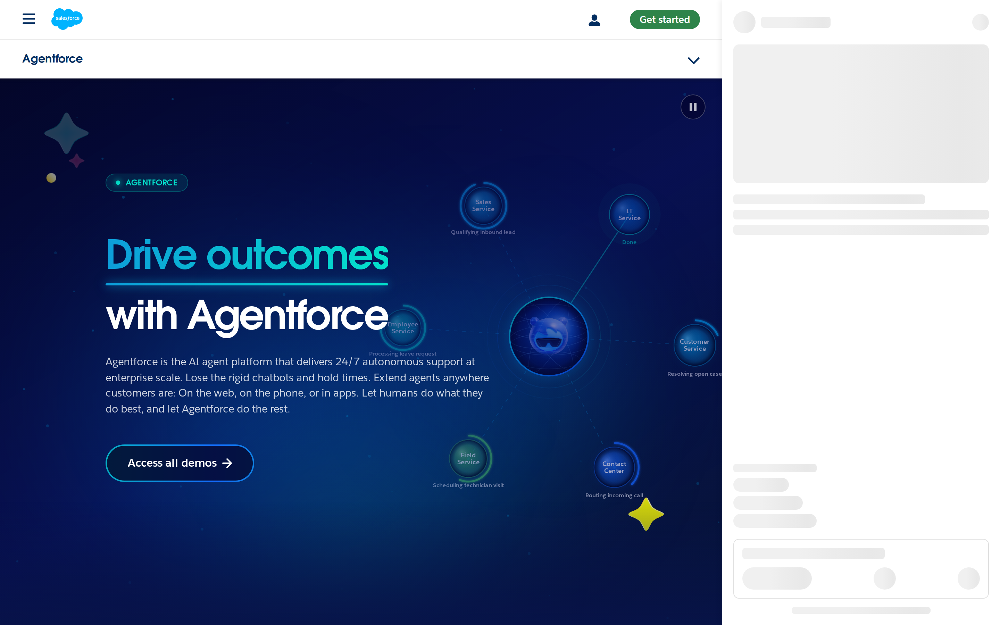
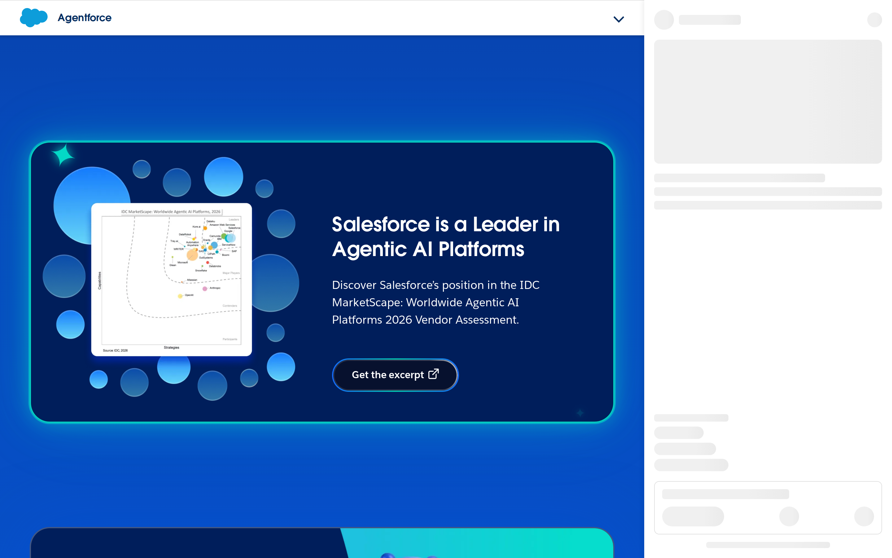
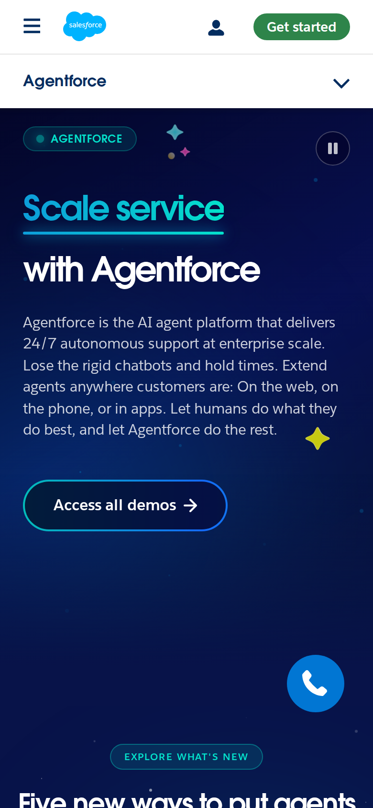

# Salesforce Agentforce signed-out page: promise clarity audit

## Evaluation summary

Comparison summary

What changed since the baseline: the page retains the same strong visual system and hero treatment but a top announcement strip present in the baseline screenshots is not visible in the current capture. The hero headline, large type scale, and primary CTA remain visually dominant and unchanged, so the page still communicates a clear primary message within seconds. The removal of the announcement strip reduces competing chrome above the hero and makes the hero feel slightly more focused.

Patterns worth borrowing

- Bold, two-line hero headline with strong size contrast and generous negative space that makes the product promise scannable. The CTA uses clear affordance and sits visually close to the copy, which helps conversion-focused discovery.  
- Consistent color and motif system (deep blue gradients, teal accents, rounded card frames and circular icons) that unifies sections and reduces perceptual friction.  
- Modular mid-page cards for proof points and excerpts that can be scanned independently.

Anti-patterns to avoid

- Announcement strips or banners that compete with the hero for attention. When persistent and brightly colored they reduce the hero's immediate impact.  
- Excessive decorative floating elements that do not carry semantic meaning; they can distract in crowded contexts and make visual hierarchy harder to parse.  
- Long, dense scrolling without clear microheadings or anchors for rapid scanning.

What the captures actually demonstrate

- Current above-the-fold and mobile screenshots show the large hero headline, supporting paragraph, and a prominent "Access all demos" button with unchanged styling.  
- Baseline above-the-fold screenshot shows a bright blue announcement banner (a webinar callout) above the hero; that banner is absent in the current above-the-fold capture.  
- The design language (fonts, colors, CTA styling, circular motifs) remains consistent between baseline and current captures, supporting the conclusion that this is an intentional, coherent system rather than a redesign.

## Evidence

- Target URL: https://www.salesforce.com/agentforce/
- Canonical URL: https://www.salesforce.com/agentforce/
- [Page text](screenshots/2026-W44_salesforce-agentforce-signed-out-page-promise-clarity-audit_40732910308_1/page-text.txt)
- [HTML snapshot](screenshots/2026-W44_salesforce-agentforce-signed-out-page-promise-clarity-audit_40732910308_1/page-content.html)

*Desktop viewport: above the fold.*

*Desktop viewport: full page.*

*Desktop viewport: mid-page.*

*Mobile viewport.*

## Primary lens review

| Dimension | Score | Rationale |
|---|---:|---|
| Singular message | 1/5 | This field is intentionally left blank—craft-only run; primary lens content evaluated separately. |
| Audience alignment | 1/5 | This field is intentionally left blank—craft-only run; primary lens content evaluated separately. |
| CTA focus | 1/5 | This field is intentionally left blank—craft-only run; primary lens content evaluated separately. |
| Claim specificity | 1/5 | This field is intentionally left blank—craft-only run; primary lens content evaluated separately. |
| Redundancy | 1/5 | This field is intentionally left blank—craft-only run; primary lens content evaluated separately. |
| **Total** | **5/25** | **AI subtotal.** |

### Human review

| Dimension | AI score | Human score | Notes |
|---|---:|---:|---|
| Singular message | 1/5 |  |  |
| Audience alignment | 1/5 |  |  |
| CTA focus | 1/5 |  |  |
| Claim specificity | 1/5 |  |  |
| Redundancy | 1/5 |  |  |
| **Total** | **5/25** |  |  |

## Craft review

Delta summary

Reassessed dimensions only where the visual evidence shows a material difference from the baseline. The visual system, hero layout, typography, and CTA styling are unchanged and continue to read as a unified design. The one material change visible in the captures is the removal of a high-contrast announcement strip that previously sat above the hero; that change reduces competing chrome and lowers information noise above the fold.

Reassessed against prior craft reference: [weekly-eval-bets/2026-W44_salesforce-agentforce-signed-out-page-first-impression-craft_40542275795_1.md](2026-W44_salesforce-agentforce-signed-out-page-first-impression-craft_40542275795_1.md).

| Dimension | Prior | New | Rationale | Change evidence |
|---|---:|---:|---|---|
| Information density | 4/5 | 5/5 | The top-level announcement banner that appeared in the baseline screenshots is absent in the current above-the-fold capture, reducing competing chrome above the hero and clarifying the page's focal area. With the banner gone, the hero and its primary CTA occupy the intended visual priority and the initial screen shows fewer competing links and copy blocks. | Baseline evidence: baseline above-the-fold screenshot shows a bright blue announcement strip with a webinar callout across the top of the page (baseline above-the-fold.png) which introduced a high-contrast horizontal element above the hero. Current evidence: current above-the-fold screenshot lacks that banner and shows uninterrupted header + hero (above-the-fold.png). The captured page text and screenshots confirm the webinar strip copy present in baseline is not in the current captured DOM/text, demonstrating reduced on-page noise above the hero. |

Current AI craft total: **32/35**, combining reassessed dimensions with unchanged inherited AI scores. This is not a new human total.

### Human craft review

| Dimension | Prior AI | New AI | Human score | Notes |
|---|---:|---:|---:|---|
| Information density | 4/5 | 5/5 |  |  |

## Human verdict

Reviewed:

[ ] Confirmed / [ ] Needs revision

Record any scope exclusions explicitly. Confirmation applies only to the supplied human ratings or validation.

*Scoring model: gpt-5-mini*
*Status: auto-scored, pending human review*
