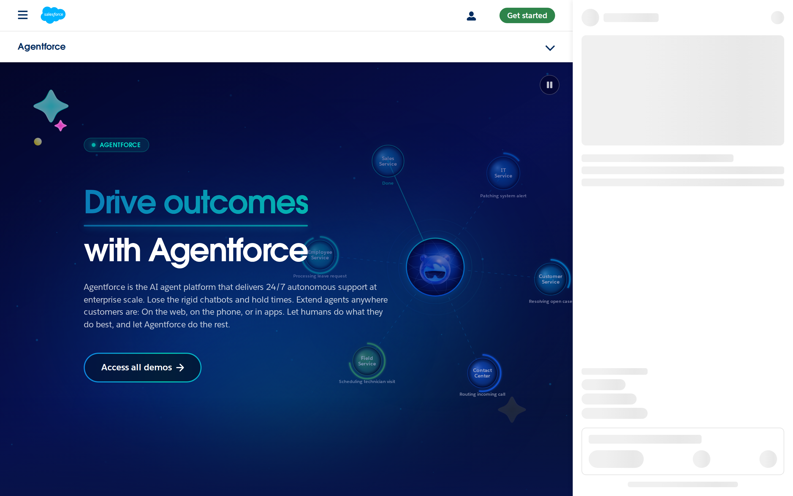
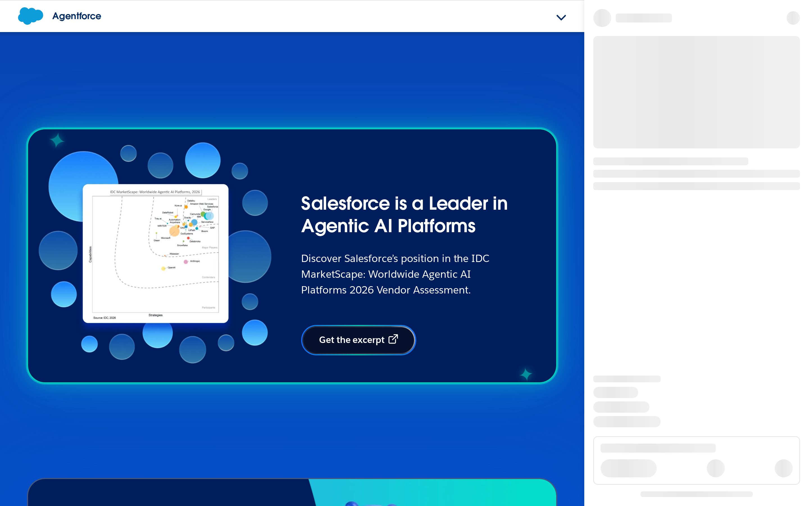
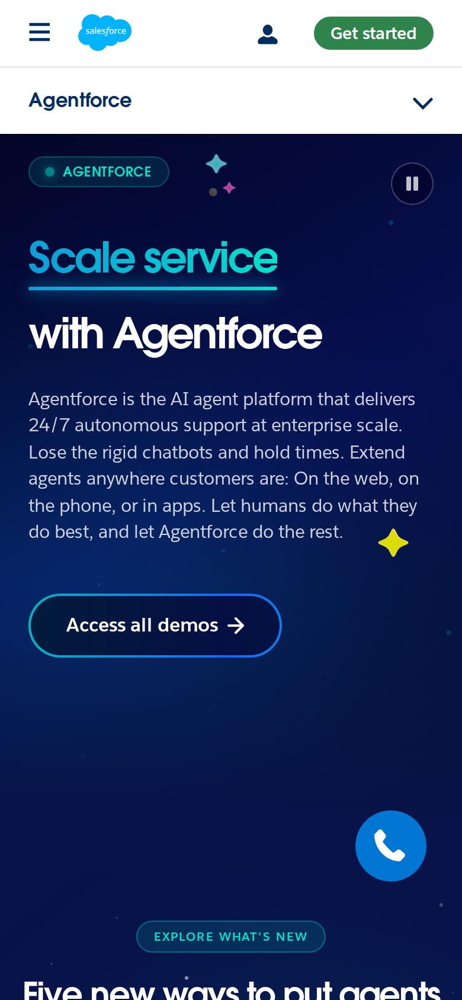

# Salesforce Agentforce signed-out page: trust architecture

## Evaluation summary

The Agentforce signed-out page presents a confident, product-first trust architecture: a large promise-driven hero, a single prominent primary CTA (Access all demos), and multiple downstream trust signals (G2/IDC mentions, customer proof sections and FAQs). Patterns worth borrowing: a bold two-line hero that states the outcome and platform name, a single large primary CTA above the fold, and visible third-party endorsements (G2/IDC) that follow the hero. Anti-patterns to avoid: burying the primary CTA behind competing banners or dense navigation, vague benefit language without quick evidence, and scattering small competing CTAs that dilute the first user decision.

## Evidence

- Target URL: https://www.salesforce.com/agentforce/
- Canonical URL: https://www.salesforce.com/agentforce/
- [Page text](screenshots/2026-W44_salesforce-agentforce-signed-out-page-trust-architecture_40921012201_1/page-text.txt)
- [HTML snapshot](screenshots/2026-W44_salesforce-agentforce-signed-out-page-trust-architecture_40921012201_1/page-content.html)

*Desktop viewport: above the fold.*

*Desktop viewport: full page.*

*Desktop viewport: mid-page.*

*Mobile viewport.*

## Primary lens review

| Dimension | Score | Rationale |
|---|---:|---|
| Sequence | 4/5 | The page leads with a strong outcome-focused hero ('Drive outcomes with Agentforce') and an obvious next step CTA, then surfaces product capabilities and proof (customer proof, IDC excerpt, guides). The ordering supports a cold visitor's trust journey, though some proof points sit lower on the page and require scrolling. |
| Specificity | 3/5 | The page includes some specific claims (24/7 autonomous support, 'Over 18K companies', IDC/G2 endorsements), but most benefits are described at a high level without quantified ROI, concrete success metrics, or short exemplar use cases in the hero region. |
| Social proof quality | 4/5 | High-quality third-party signals appear (IDC MarketScape, G2 leader badges) and a company-count claim is present, which are credible trust anchors; however, prominent customer logos or succinct testimonial snippets are not above the fold to accelerate trust instantly. |
| Friction to first action | 5/5 | A single, visually dominant primary CTA ('Access all demos') is available in the hero and clearly actionable, reducing friction for exploration from new visitors; header CTAs are present but do not obscure the hero action. |
| Risk reduction | 3/5 | The site provides supporting content (excerpts, guides, FAQs, demos) that reduce perceived risk for buyers, but explicit assurances about security, compliance, implementation timelines, or pricing clarity are not prominent on the initial screen. |
| **Total** | **19/25** | **AI subtotal.** |

### Human review

| Dimension | AI score | Human score | Notes |
|---|---:|---:|---|
| Sequence | 4/5 |  |  |
| Specificity | 3/5 |  |  |
| Social proof quality | 4/5 |  |  |
| Friction to first action | 5/5 |  |  |
| Risk reduction | 3/5 |  |  |
| **Total** | **19/25** |  |  |

## Craft review

I compared the current captures to the baseline (weekly-eval-bets/2026-W44... promise-clarity-audit) and found no material visual changes to the page's top-level design craft. The hero composition, typography scale, primary CTA prominence, color system, and the presence of trust sections (IDC/G2 references, customer proof) remain consistent. Because the page structure and above-the-fold arrangement are effectively unchanged, no craft dimension required rescoring.

Evidence changed, but no materially relevant craft dimensions changed. The originating baseline remains [weekly-eval-bets/2026-W44_salesforce-agentforce-signed-out-page-promise-clarity-audit_40732910308_1.md](2026-W44_salesforce-agentforce-signed-out-page-promise-clarity-audit_40732910308_1.md).

Baseline craft scores remain valid. Current screenshots and HTML show the same hero layout, dominant headline and CTA, consistent color/shape system, and the same downstream proof blocks as the baseline. There is no visible new chrome, removed hero element, or typographic/systemic change that would materially affect visual hierarchy, information density, readability, coherence, durability, or intentionality compared with the baseline evidence.

## Human verdict

Reviewed:

[ ] Confirmed / [ ] Needs revision

Record any scope exclusions explicitly. Confirmation applies only to the supplied human ratings or validation.

*Scoring model: gpt-5-mini*
*Status: auto-scored, pending human review*
