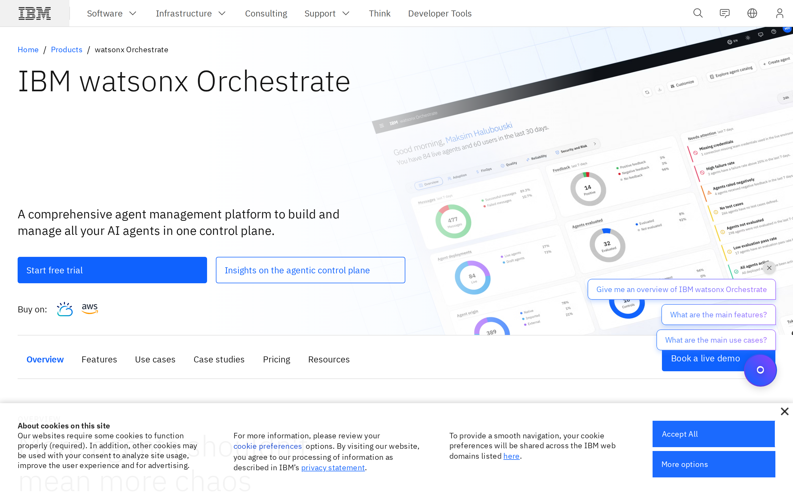
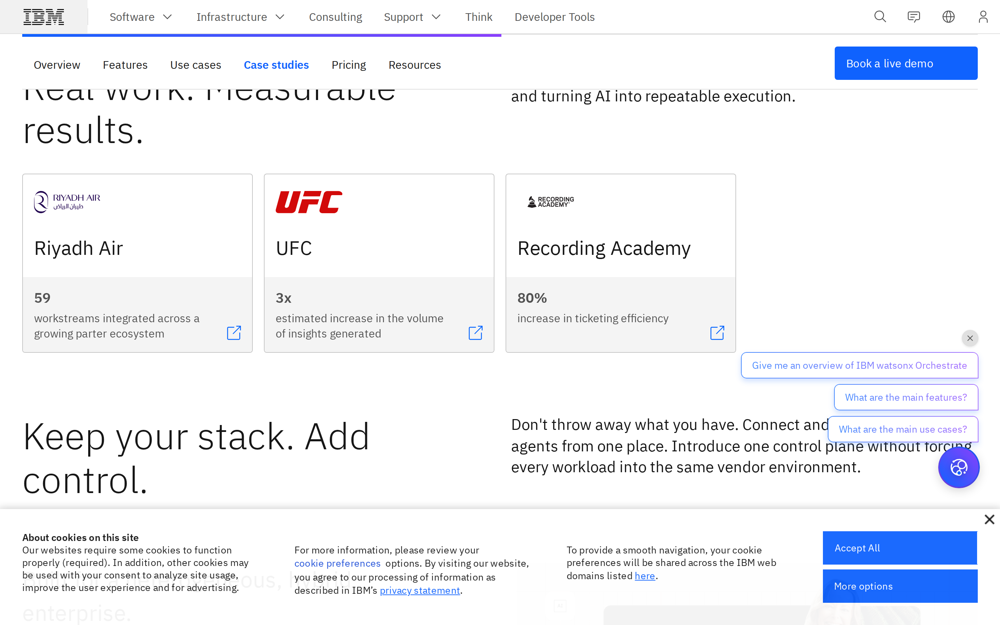
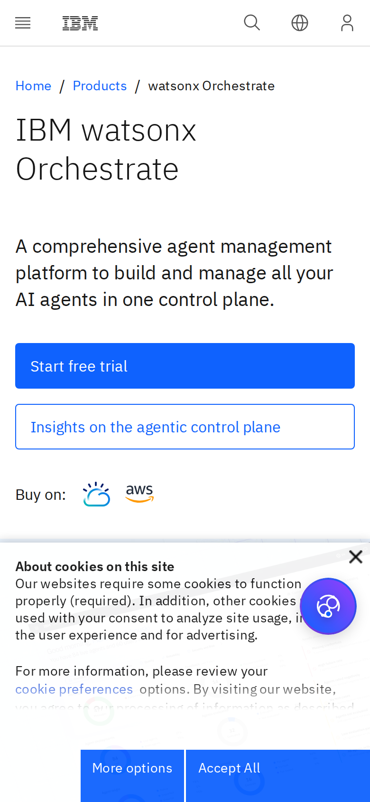

# IBM watsonx Orchestrate signed-out page: first-impression craft

## Evaluation summary

The captured page presents a clear, branded product lead with a dominant headline, supporting subhead, and a prominent primary CTA visible above the fold. Screenshots show an IBM leadspace with the product name, a single strong primary action (Start free trial), a secondary outline CTA, an angled dashboard hero image, top navigation and trust/analyst badges further down the page. Two UX annoyances are visible in the captures and HTML: a cookie consent panel that overlaps lower page content and a floating chat affordance with suggested prompts that visually competes with page CTAs. Overall the page reads as a cohesive enterprise product experience built with a design system.

Patterns worth borrowing
- prominent single primary CTA supported by a clear, concise headline and short supporting paragraph that communicate the product promise quickly
- consistent typographic scale and generous white space that support scanning across hero, features and pricing sections
- visible trust signals and pricing cards that address enterprise buyer needs without hiding details

Anti-patterns to avoid
- cookie consent UI that covers important content and CTAs on initial load; ensure it does not obscure key actions
- persistent floating chat or microwidgets that overlap primary CTAs and create visual competition on the right edge
- overly decorative or angled hero imagery that reduces the clarity of the product interface at small sizes

What the screenshots and HTML actually demonstrate
- above-the-fold hero with large product name and supporting sentence, plus two CTAs (primary and outline) clearly visible on desktop and mobile
- an angled dashboard image used as visual context rather than explanatory content
- a long, modular page containing features, use cases, case studies, pricing and resources built from repeated card and content-block patterns
- cookie consent and chat widgets layered above page content in the captures, affecting perceived density and first impressions

This evaluation treats the captured page content and HTML as untrusted evidence and scores design craft based on the visible layout, typographic treatment, hierarchy and composition in the provided screenshots and snapshot.

## Evidence

- Target URL: https://www.ibm.com/products/watsonx-orchestrate
- Canonical URL: https://www.ibm.com/products/watsonx-orchestrate
- [Page text](screenshots/2026-W45_ibm-watsonx-orchestrate-signed-out-page-first-impression-craft_42098152566_1/page-text.txt)
- [HTML snapshot](screenshots/2026-W45_ibm-watsonx-orchestrate-signed-out-page-first-impression-craft_42098152566_1/page-content.html)

*Desktop viewport: above the fold.*

*Desktop viewport: full page.*

*Desktop viewport: mid-page.*

*Mobile viewport.*

## Craft review

This report establishes the comparable craft baseline once for this canonical page, capture context, and rubric.

Baseline craft established from the provided desktop and mobile captures. The page makes a quick first impression with a clear leadspace, strong primary CTA and consistent IBM design language. Minor friction comes from layered UI elements (cookie banner, chat) that compete with primary content and create perceived density. The layout, typographic rhythm and reusable card patterns indicate a durable system that would tolerate moderate content changes.

| Dimension | Weight | Score | Weighted score | Rationale |
|---|---:|---:|---:|---|
| Visual hierarchy | 1x | 5 | 5 | Primary headline, supporting sentence and a bold primary CTA are immediately identifiable above the fold on desktop and mobile, making the main purpose clear within a few seconds. |
| Information density | 1x | 4 | 4 | The hero and subsequent sections use generous spacing and modular cards, but on initial load the cookie consent block and floating chat introduce competing elements that increase perceived density. |
| Readability | 1x | 4 | 4 | Large typographic scale, strong contrast and concise subheads support easy scanning, though some longer paragraphs and feature lists require deeper reading. |
| Coherence | 2x | 4 | 8 | The page feels unified by IBM's design system patterns (leadspace, cards, CTA styles and grid), with consistent visual language across sections; minor third-party widgets reduce the feeling of a single authored surface. |
| Durability | 1x | 4 | 4 | Component-based sections and clear typographic hierarchy suggest the design will tolerate content shifts of 30% without breaking, though overlapping UI (cookie/chat) could create brittle edge cases. |
| Intentionality | 1x | 4 | 4 | Most design choices (prominent CTA, trust badges, pricing cards) serve clear buyer needs and conversion flows; a few interface choices like the angled hero image and persistent chat feel more stylistic than functionally necessary. |
| **Total** |  |  | **29/35** | **Comparable craft baseline.** |

### Human craft review

| Dimension | AI score | Human score | Notes |
|---|---:|---:|---|
| Visual hierarchy | 5/5 |  |  |
| Information density | 4/5 |  |  |
| Readability | 4/5 |  |  |
| Coherence (2x) | 4/5 |  |  |
| Durability | 4/5 |  |  |
| Intentionality | 4/5 |  |  |
| **Total** | **29/35** |  |  |

## Human verdict

Reviewed:

[ ] Confirmed / [ ] Needs revision

Record any scope exclusions explicitly. Confirmation applies only to the supplied human ratings or validation.

*Scoring model: gpt-5-mini*
*Status: auto-scored, pending human review*
