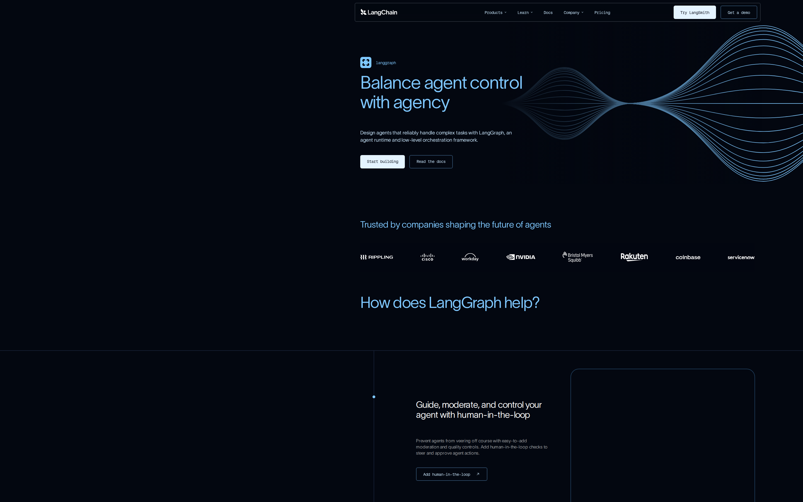
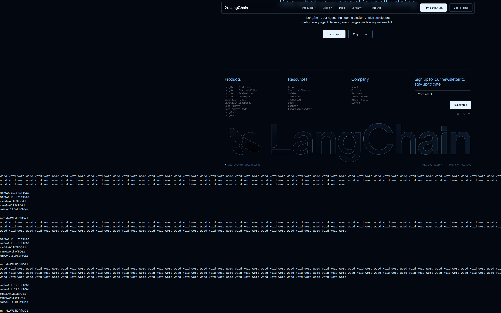

# LangChain LangGraph signed-out page: first-impression craft

## Evaluation summary

The page presents a clear hero: a concise headline "Balance agent control with agency", a short supporting paragraph, and two primary CTAs visible above the fold alongside a decorative waveform motif and a row of customer logos; screenshots confirm a dark theme, strong left-aligned content, and large empty or noisy areas further down the page (including repeated placeholder text in the captured content). Patterns worth borrowing: a single clear hero message with proximate CTAs, a restrained palette and consistent visual motif, and an immediate trust band of customer logos. Anti-patterns to avoid: visible placeholder or repeated dump text that breaks trust, large empty vertical gaps that dilute momentum, and using a coding/monospace font for long body copy which can reduce scanning comfort.

## Evidence

- Target URL: https://www.langchain.com/langgraph
- Canonical URL: https://www.langchain.com/langgraph
- [Page text](screenshots/2026-W45_langchain-langgraph-signed-out-page-first-impression-craft_41530577000_1/page-text.txt)
- [HTML snapshot](screenshots/2026-W45_langchain-langgraph-signed-out-page-first-impression-craft_41530577000_1/page-content.html)

*Desktop viewport: above the fold.*

*Desktop viewport: full page.*

*Desktop viewport: mid-page.*

*Mobile viewport.*

## Craft review

This report establishes the comparable craft baseline once for this canonical page, capture context, and rubric.

Baseline established for first-impression craft. The hero communicates the primary promise and actions quickly and the page uses a coherent dark-blue visual system, but noisy placeholder content and large empty areas later on reduce polish and signal some content-quality issues that should be fixed before reuse or comparison.

| Dimension | Weight | Score | Weighted score | Rationale |
|---|---:|---:|---:|---|
| Visual hierarchy | 1x | 4 | 4 | The hero headline, short supporting copy, and two CTAs are visually prominent and findable within seconds, supported by a large decorative waveform that frames the right side of the area. |
| Information density | 1x | 3 | 3 | Above the fold is clean and purposeful with a clear trust band, but the page contains long vertical spacing and repeated placeholder text lower down that creates noise and reduces the sense that every element earns its space. |
| Readability | 1x | 3 | 3 | Headlines and CTAs read clearly on the high-contrast dark background, but the site includes JetBrains Mono and some small or dense blocks of text that make longer paragraphs and footer content harder to scan comfortably. |
| Coherence | 2x | 4 | 8 | The site feels like one designed thing at first glance with a consistent dark theme, blue accents, and shared iconography, though the abrupt presence of placeholder dumps and mismatched content sections weakens the unified experience. |
| Durability | 1x | 4 | 4 | The modular section structure, clear hero, and restrained visual language suggest the design would survive moderate content changes, but brittle areas include long empty regions and hardcoded filler that could break if copy changes substantially. |
| Intentionality | 1x | 3 | 3 | Most decisions (hero-first messaging, trust logos, feature callouts) read as deliberate, but the choice of a monospace coding font for general copy and visible placeholder text make some decisions look accidental or unfinished. |
| **Total** |  |  | **25/35** | **Comparable craft baseline.** |

### Human craft review

| Dimension | AI score | Human score | Notes |
|---|---:|---:|---|
| Visual hierarchy | 4/5 |  |  |
| Information density | 3/5 |  |  |
| Readability | 3/5 |  |  |
| Coherence (2x) | 4/5 |  |  |
| Durability | 4/5 |  |  |
| Intentionality | 3/5 |  |  |
| **Total** | **25/35** |  |  |

## Human verdict

Reviewed:

[ ] Confirmed / [ ] Needs revision

Record any scope exclusions explicitly. Confirmation applies only to the supplied human ratings or validation.

*Scoring model: gpt-5-mini*
*Status: auto-scored, pending human review*
