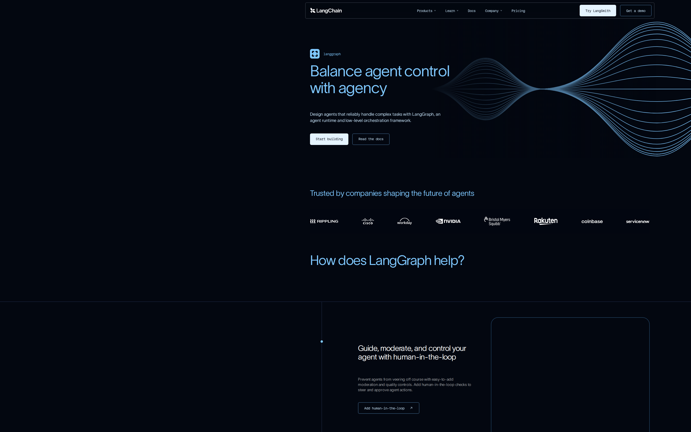
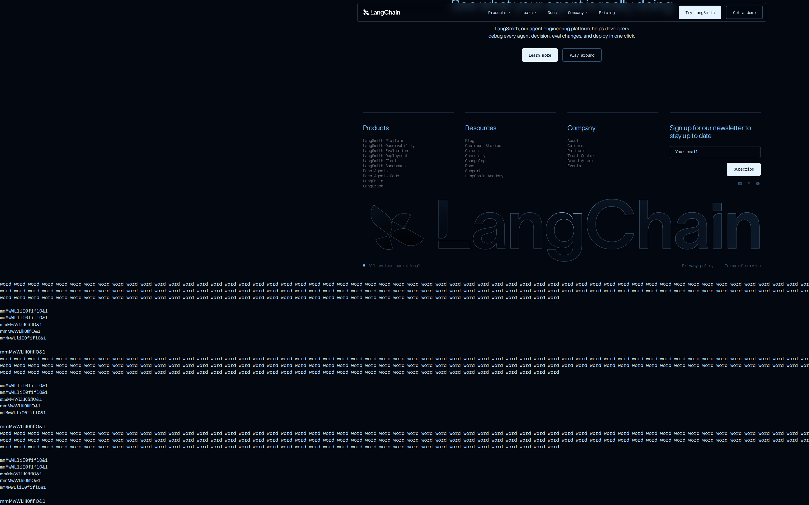

# LangChain LangGraph signed-out page: promise clarity audit

## Evaluation summary

The current capture matches the existing baseline and does not change the page promise or first impression. Patterns worth borrowing: the hero layout is clear and scannable with a short headline, supporting sentence, and two CTAs that are visually prominent; a trust band of customer logos directly under the hero helps build credibility; consistent dark theme, blue accent color, and the decorative waveform create a unified visual identity. Anti-patterns to avoid: visible placeholder dumps and repeated tokens lower on the page that create noise and look unfinished; long vertical whitespace and empty regions that break the content flow; using a monospace display font for long paragraph copy which reduces reading comfort for nontechnical visitors. This run compares the current evidence against the baseline file weekly-eval-bets/2026-W45_langchain-langgraph-signed-out-page-first-impression-craft_41530577000_1.md and finds no material craft changes.

## Evidence

- Target URL: https://www.langchain.com/langgraph
- Canonical URL: https://www.langchain.com/langgraph
- [Page text](screenshots/2026-W45_langchain-langgraph-signed-out-page-promise-clarity-audit_41703405319_1/page-text.txt)
- [HTML snapshot](screenshots/2026-W45_langchain-langgraph-signed-out-page-promise-clarity-audit_41703405319_1/page-content.html)

*Desktop viewport: above the fold.*

*Desktop viewport: full page.*

*Desktop viewport: mid-page.*

*Mobile viewport.*

## Primary lens review

| Dimension | Score | Rationale |
|---|---:|---|
| Singular message | 4/5 | The hero headline "Balance agent control with agency," a short supporting sentence, and two primary CTAs are visually prominent and deliver a single product promise within seconds. |
| Audience alignment | 3/5 | Language and feature callouts (human-in-the-loop, streaming, memory) align with developer and engineering audiences, but the use of a monospace font for general copy and dense technical phrases may slightly hinder broader product manager or nontechnical stakeholder readability. |
| CTA focus | 4/5 | Two clear CTAs (start building, read the docs) support both immediate trial and documentation exploration, and they are visually distinct in the hero area. |
| Claim specificity | 3/5 | The page lists concrete capabilities (streaming, memory, human-in-the-loop) but keeps claims at a moderately high level without measurable outcomes or quick examples that would increase credibility for unfamiliar visitors. |
| Redundancy | 2/5 | Significant repeated placeholder text and token dumps lower on the page cause noise and create redundant, distracting content that competes with the hero message. |
| **Total** | **16/25** | **AI subtotal.** |

### Human review

| Dimension | AI score | Human score | Notes |
|---|---:|---:|---|
| Singular message | 4/5 |  |  |
| Audience alignment | 3/5 |  |  |
| CTA focus | 4/5 |  |  |
| Claim specificity | 3/5 |  |  |
| Redundancy | 2/5 |  |  |
| **Total** | **16/25** |  |  |

## Craft review

No craft dimensions were materially changed since the prior baseline. I inspected the hero area (headline, supporting copy, CTAs, decorative waveform), the trust band, the feature callouts, the midpage sections, and the raw placeholder text found lower on the page. All visible layout, typographic, and content artifacts in the current capture match the baseline evidence, so no reassessment of craft scores was required.

Evidence changed, but no materially relevant craft dimensions changed. The originating baseline remains [weekly-eval-bets/2026-W45_langchain-langgraph-signed-out-page-first-impression-craft_41530577000_1.md](2026-W45_langchain-langgraph-signed-out-page-first-impression-craft_41530577000_1.md).

Compared with the baseline report, the current capture shows the same hero headline and supporting copy, the same pair of CTAs, the identical trust logo band, the same section ordering for feature callouts, and the same placeholder and repeated-token content lower on the page. Screenshots and the HTML snapshot show no structural or visual updates that would alter visual hierarchy, information density, readability, coherence, durability, or intentionality. Because the visible evidence is effectively unchanged from the baseline, there are no materially changed craft dimensions to rescore.

## Human verdict

Reviewed:

[ ] Confirmed / [ ] Needs revision

Record any scope exclusions explicitly. Confirmation applies only to the supplied human ratings or validation.

*Scoring model: gpt-5-mini*
*Status: auto-scored, pending human review*
