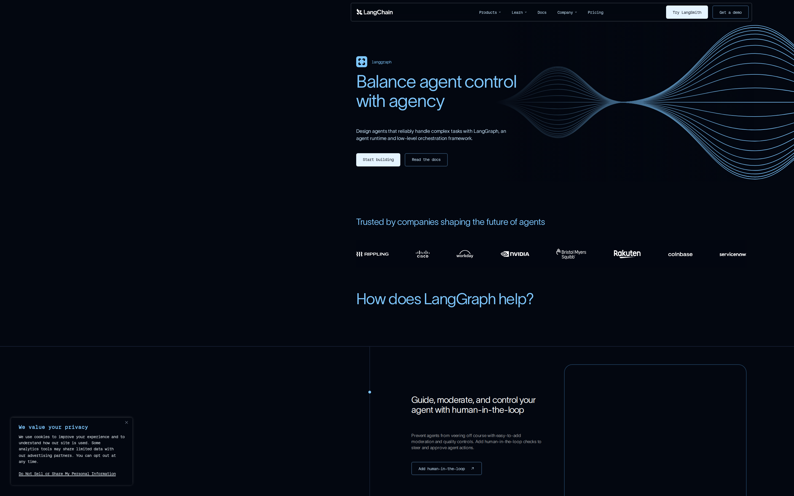
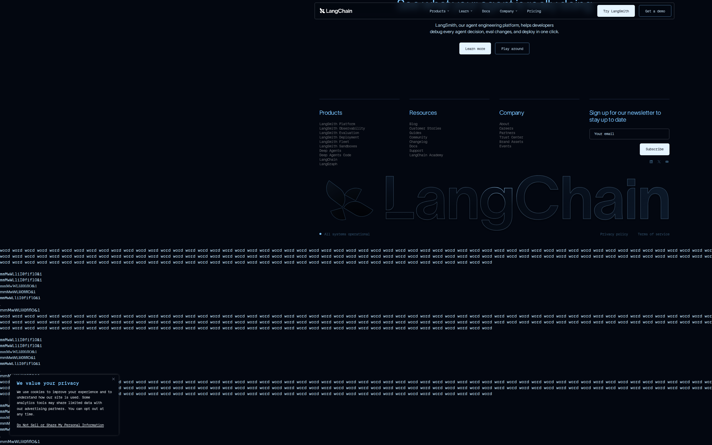
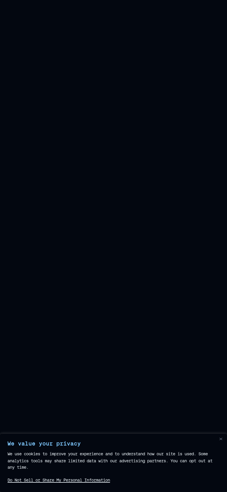

# LangChain LangGraph signed-out page: trust architecture

## Evaluation summary

Quick summary. The LangGraph signed-out page still delivers a clear hero, prominent CTAs, and strong social proof (logos and customer quotes) that establish a credible first impression for technical audiences. Compared with the prior baseline, the page appears functionally unchanged in layout and headline hierarchy, but noisy placeholder dumps and repeated filler visible in the captured render weaken information density and make the page feel less polished. Patterns worth borrowing: a focused hero with short supporting copy and two clear CTAs; a visible trust band of logos and named testimonials; consistent dark theme and restrained color accents that support a technical brand. Anti-patterns to avoid: leaving visible placeholder or dump text in production; allowing cookie or modal UI to obscure important CTAs or trust signals; overusing a monospace code font for general body copy which reduces scanning speed.

## Evidence

- Target URL: https://www.langchain.com/langgraph
- Canonical URL: https://www.langchain.com/langgraph
- [Page text](screenshots/2026-W45_langchain-langgraph-signed-out-page-trust-architecture_41899564877_1/page-text.txt)
- [HTML snapshot](screenshots/2026-W45_langchain-langgraph-signed-out-page-trust-architecture_41899564877_1/page-content.html)

*Desktop viewport: above the fold.*

*Desktop viewport: full page.*

*Desktop viewport: mid-page.*

*Mobile viewport.*

## Primary lens review

| Dimension | Score | Rationale |
|---|---:|---|
| Sequence | 4/5 | The content follows a sensible order: hero headline and CTAs first, followed by trust logos, then feature sections and FAQs — the navigation and flow make it easy to understand what the product is and where to go next. |
| Specificity | 3/5 | The page highlights concrete capabilities (streaming, memory, human-in-the-loop, MIT license) but many claims are brief and high level rather than calling out metrics, example use cases, or concrete success criteria. |
| Social proof quality | 4/5 | A trust band of recognizable company logos and three named quotes (with roles) signal credible enterprise adoption and lend authority to the offering. |
| Friction to first action | 4/5 | Primary CTAs are visible in the hero (Start building, Read the docs) and the nav provides direct product and docs links; a cookie/privacy widget is present but does not fully block the primary actions in the hero. |
| Risk reduction | 3/5 | Risk-mitigating details exist (open source license, FAQ, observability/controls) but the page lacks deeper trust artifacts such as security badges, clear SLA or TOS callouts near the conversion points, or short case studies with measurable outcomes. |
| **Total** | **18/25** | **AI subtotal.** |

### Human review

| Dimension | AI score | Human score | Notes |
|---|---:|---:|---|
| Sequence | 4/5 |  |  |
| Specificity | 3/5 |  |  |
| Social proof quality | 4/5 |  |  |
| Friction to first action | 4/5 |  |  |
| Risk reduction | 3/5 |  |  |
| **Total** | **18/25** |  |  |

## Craft review

Delta summary vs baseline. The hero, primary messaging, and trust band remain intact from the baseline, so visual hierarchy is preserved. However, the captured render shows increased visible placeholder and dump text across lower sections and more prominent cookie/opt-out UI in the viewport; these issues materially reduce information density, coherence, durability, and apparent intentionality compared with the baseline evidence. Keep the hero structure and trust band, and remove any leftover placeholder text from production builds; ensure privacy banners are visually subordinate and do not obscure CTAs.

Reassessed against prior craft reference: [weekly-eval-bets/2026-W45_langchain-langgraph-signed-out-page-first-impression-craft_41530577000_1.md](2026-W45_langchain-langgraph-signed-out-page-first-impression-craft_41530577000_1.md).

| Dimension | Prior | New | Rationale | Change evidence |
|---|---:|---:|---|---|
| Information density | 3/5 | 2/5 | The page contains large regions of repeated filler and dumped strings visible in the screenshots and text capture, which create visual noise and compete with the product signal. | Baseline score 3. New score 2. Evidence: current full-page and mid-page screenshots show repeated 'word word ...' blocks and sequences like 'mmMwWLliI0fiflO&1' visibly interspersed through the lower page; HTML/text capture includes the same filler blocks. This increases noise and reduces the sense that every element earns its space. |
| Coherence | 4/5 | 3/5 | Visible placeholder dumps and scattered filler weaken the feeling of a single, polished design system even though hero and trust elements remain consistent. | Baseline score 4. New score 3. Evidence: baseline noted a generally unified dark theme with some filler; current captures show the same theme but with expanded, clearly visible placeholder content across multiple sections and footer, making the page feel assembled rather than fully finished. |
| Durability | 4/5 | 3/5 | The presence of visible placeholder and hardcoded filler suggests brittle content handling that could break or expose debugging artifacts when copy or data changes. | Baseline score 4. New score 3. Evidence: HTML snapshot and page text reveal long repeated placeholder strings and debugging-like tokens; these indicate fragility if content pipelines or CMS outputs unexpected values, reducing confidence the design will hold under content changes. |
| Intentionality | 3/5 | 2/5 | Design decisions feel less deliberate where production-facing placeholder content and odd character sequences appear; that undermines trust in craftsmanship even though hero choices remain purposeful. | Baseline score 3. New score 2. Evidence: baseline flagged some questionable font and filler choices; current capture shows explicit placeholder dumps and non-lexical tokens in visible areas plus a cookie UI placed over content, reinforcing the impression of accidental or unfinished decisions. |

Current AI craft total: **20/35**, combining reassessed dimensions with unchanged inherited AI scores. This is not a new human total.

### Human craft review

| Dimension | Prior AI | New AI | Human score | Notes |
|---|---:|---:|---:|---|
| Information density | 3/5 | 2/5 |  |  |
| Coherence (2x) | 4/5 | 3/5 |  |  |
| Durability | 4/5 | 3/5 |  |  |
| Intentionality | 3/5 | 2/5 |  |  |

## Human verdict

Reviewed:

[ ] Confirmed / [ ] Needs revision

Record any scope exclusions explicitly. Confirmation applies only to the supplied human ratings or validation.

*Scoring model: gpt-5-mini*
*Status: auto-scored, pending human review*
