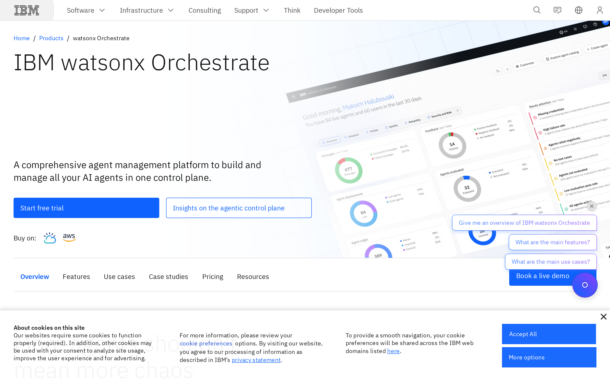
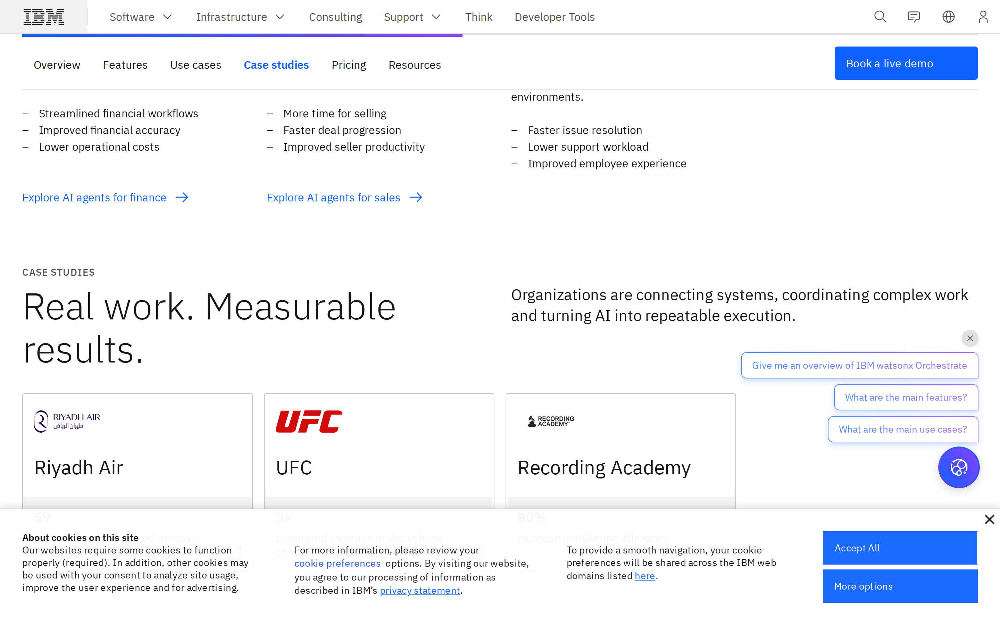
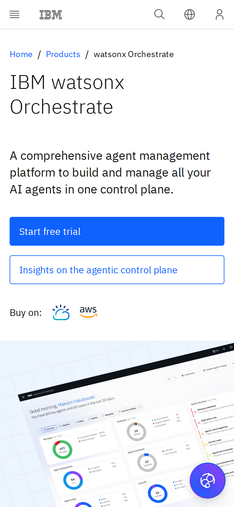

# IBM watsonx Orchestrate signed-out page: promise clarity audit

## Evaluation summary

Baseline evaluation (promise clarity): the watsonx Orchestrate landing page communicates a clear product promise — an "agent management control plane" — with a large headline, explanatory subhead and a dominant primary CTA (Start free trial) visible above the fold. The hero dashboard image reinforces the control-plane concept but is decorative and tilts the eye away from the copy; trust signals (Gartner, IDC) and feature sections support the promise further down the page. Primary strengths to borrow include a prominent headline and a high-contrast primary CTA, modular content blocks that map to buyer concerns, and visible analyst recognition that builds credibility. Key anti-patterns to avoid are intrusive overlays and floating widgets that occlude the hero content (cookie consent and chat widget), multiple competing CTAs without clear prioritization, and decorative visuals that reduce immediate legibility of the lead message. Screenshots show a clean leadspace with a large product name, a single-line explanatory subhead, two visible CTAs, cloud marketplace icons, and a diagonal product screenshot; mid- and lower-page screenshots show modular feature, use-case and pricing sections and analyst callouts, while the cookie consent bar and circular chat widget persistently overlap page content.

## Evidence

- Target URL: https://www.ibm.com/products/watsonx-orchestrate
- Canonical URL: https://www.ibm.com/products/watsonx-orchestrate
- [Page text](screenshots/2026-W46_ibm-watsonx-orchestrate-signed-out-page-promise-clarity-audit_42732611096_1/page-text.txt)
- [HTML snapshot](screenshots/2026-W46_ibm-watsonx-orchestrate-signed-out-page-promise-clarity-audit_42732611096_1/page-content.html)

*Desktop viewport: above the fold.*

*Desktop viewport: full page.*

*Desktop viewport: mid-page.*

*Mobile viewport.*

## Primary lens review

| Dimension | Score | Rationale |
|---|---:|---|
| Singular message | 1/5 | This run is craft-focused; primary lens evaluations are not included in the craft baseline output as requested. |
| Audience alignment | 1/5 | This run is craft-focused; primary lens evaluations are not included in the craft baseline output as requested. |
| CTA focus | 1/5 | This run is craft-focused; primary lens evaluations are not included in the craft baseline output as requested. |
| Claim specificity | 1/5 | This run is craft-focused; primary lens evaluations are not included in the craft baseline output as requested. |
| Redundancy | 1/5 | This run is craft-focused; primary lens evaluations are not included in the craft baseline output as requested. |
| **Total** | **5/25** | **AI subtotal.** |

### Human review

| Dimension | AI score | Human score | Notes |
|---|---:|---:|---|
| Singular message | 1/5 |  |  |
| Audience alignment | 1/5 |  |  |
| CTA focus | 1/5 |  |  |
| Claim specificity | 1/5 |  |  |
| Redundancy | 1/5 |  |  |
| **Total** | **5/25** |  |  |

## Craft review

This report establishes the comparable craft baseline once for this canonical page, capture context, and rubric.

Established baseline for visual craft and promise clarity. The page reads as a cohesive IBM product page with a clear lead promise and a dominant primary CTA above the fold; coherence and modular layout are strengths, while persistent overlays and several competing secondary CTAs introduce noise. Use this baseline for subsequent promise or audience-focused audits and update only dimensions that change materially in later captures.

| Dimension | Weight | Score | Weighted score | Rationale |
|---|---:|---:|---:|---|
| Visual hierarchy | 1x | 4 | 4 | The large product title, concise subhead and a high-contrast primary CTA are immediately visible above the fold, making the primary promise and action discoverable within a few seconds. |
| Information density | 1x | 3 | 3 | The lead area is relatively uncluttered, but multiple secondary CTAs, marketplace icons, the floating chat widget and the cookie consent bar add competing elements that dilute signal. |
| Readability | 1x | 4 | 4 | Typography scale, line length and contrast support quick scanning and comprehension of the headline and subhead across desktop and mobile. |
| Coherence | 2x | 4 | 8 | The page uses a consistent IBM Carbon layout and component vocabulary across sections so the site reads as one designed experience, though some sections feel densely packed and could better emphasize relationship to the lead promise. |
| Durability | 1x | 4 | 4 | The modular content blocks and clear leadspace should tolerate 30% content change without breaking the overall promise, but persistent overlays and the angled hero image reduce resilience if messaging or imagery change significantly. |
| Intentionality | 1x | 4 | 4 | Most design choices — prominent CTA, analyst callouts, modular use-case blocks — clearly support the control-plane promise, although the presence and placement of multiple secondary CTAs and the chat bubble feel less deliberate and more likely to distract. |
| **Total** |  |  | **27/35** | **Comparable craft baseline.** |

### Human craft review

| Dimension | AI score | Human score | Notes |
|---|---:|---:|---|
| Visual hierarchy | 4/5 |  |  |
| Information density | 3/5 |  |  |
| Readability | 4/5 |  |  |
| Coherence (2x) | 4/5 |  |  |
| Durability | 4/5 |  |  |
| Intentionality | 4/5 |  |  |
| **Total** | **27/35** |  |  |

## Human verdict

Reviewed:

[ ] Confirmed / [ ] Needs revision

Record any scope exclusions explicitly. Confirmation applies only to the supplied human ratings or validation.

*Scoring model: gpt-5-mini*
*Status: auto-scored, pending human review*
