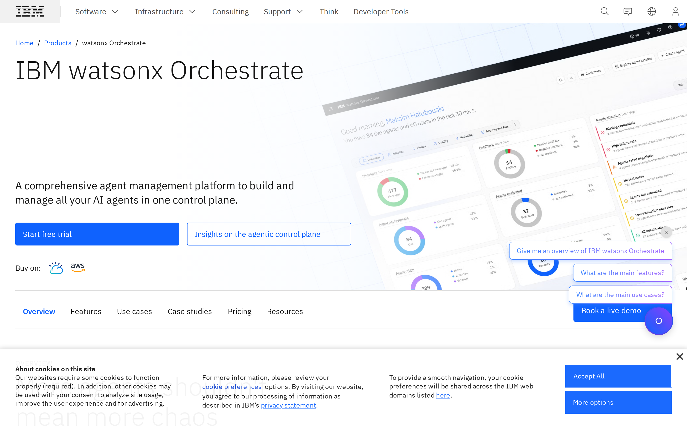
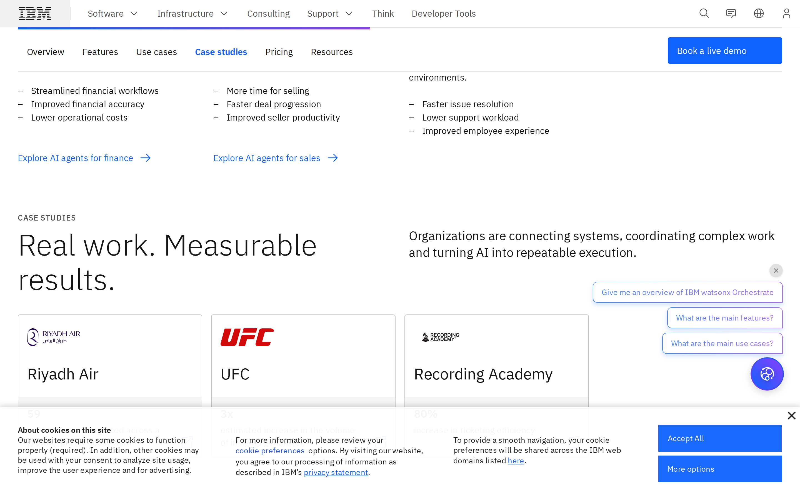
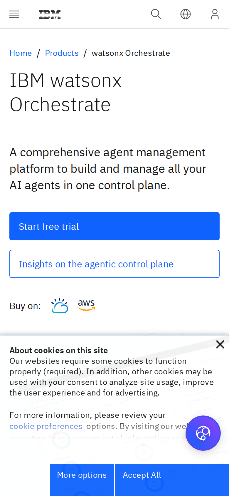

# IBM watsonx Orchestrate signed-out page: trust architecture

## Evaluation summary

What the evidence shows: screenshots and the page HTML show the same signed-out product leadspace and modular content that appeared in the baseline: a large product title and concise subhead, a high-contrast primary CTA (Start free trial), a secondary outline CTA, analyst badges and case-study tiles further down, pricing blocks, and persistent interactive elements (a floating chat bubble with preset prompts and a cookie consent bar). The cookie consent overlay is visible on desktop and covers a large portion of the bottom of the viewport on mobile. The hero image is angled and decorative; CTAs and analyst callouts appear in expected places. Comparison with the baseline: I found no material design or layout changes in the captured evidence that would require reassessing previously recorded craft scores. Patterns worth borrowing: 1) A clear, large product headline and concise subhead that communicates the promise quickly. 2) A prominent, high-contrast primary CTA placed near the promise. 3) Analyst badges and case-study logos placed close to the product story to support credibility. 4) Modular content blocks that let visitors scan features, use cases, and pricing. Anti-patterns to avoid: 1) Persistent overlays (cookie consent, chat bubble) that compete visually with the primary CTA and reduce perceived trust if they obscure content, especially on small screens. 2) Multiple equally prominent secondary CTAs and widgets that divide attention from the main action. 3) Relying on broad claims in the lead without immediate, nearby specific trust signals (brief security, compliance, or measurable outcomes) next to the primary CTA.

## Evidence

- Target URL: https://www.ibm.com/products/watsonx-orchestrate
- Canonical URL: https://www.ibm.com/products/watsonx-orchestrate
- [Page text](screenshots/2026-W46_ibm-watsonx-orchestrate-signed-out-page-trust-architecture_42887605093_1/page-text.txt)
- [HTML snapshot](screenshots/2026-W46_ibm-watsonx-orchestrate-signed-out-page-trust-architecture_42887605093_1/page-content.html)

*Desktop viewport: above the fold.*

*Desktop viewport: full page.*

*Desktop viewport: mid-page.*

*Mobile viewport.*

## Primary lens review

| Dimension | Score | Rationale |
|---|---:|---|
| Sequence | 4/5 | The page places the product name, short promise and a clear primary CTA above the fold, followed by credibility cues (analyst badges) and then features, use cases and case studies, so the information flow supports a signed-out visitor building trust in a logical order. |
| Specificity | 3/5 | The page includes some concrete case-study metrics and product details in later sections, but the hero promise remains high level and does not surface immediate, specific trust data (security certifications, concrete uptime or large-customer counts) near the primary CTA. |
| Social proof quality | 4/5 | There are recognized analyst badges and case-study tiles with logos and outcome snippets visible in the captured content, which are credible social signals for enterprise buyers. |
| Friction to first action | 3/5 | A visible, high-contrast start-trial CTA reduces friction, but persistent UI elements (cookie consent bar and floating chat prompts) and multiple secondary CTAs create competing targets that can increase friction, especially on mobile where the cookie overlay covers much of the viewport. |
| Risk reduction | 4/5 | The page includes governance and security language and product tiers that mention data isolation and HIPAA readiness in pricing details, which help reduce perceived risk for enterprise buyers, though those details sit below the fold rather than directly adjacent to the main CTA. |
| **Total** | **18/25** | **AI subtotal.** |

### Human review

| Dimension | AI score | Human score | Notes |
|---|---:|---:|---|
| Sequence | 4/5 |  |  |
| Specificity | 3/5 |  |  |
| Social proof quality | 4/5 |  |  |
| Friction to first action | 3/5 |  |  |
| Risk reduction | 4/5 |  |  |
| **Total** | **18/25** |  |  |

## Craft review

Across the provided screenshots and HTML snapshot I observed no material visual or structural changes from the baseline craft evidence. The same leadspace composition, CTA prominence, analyst callouts, case-study placement, angled hero image, cookie consent bar and floating chat widget are present. Because there are no new or changed design treatments that affect the six craft dimensions materially, no craft scores needed updating.

Evidence changed, but no materially relevant craft dimensions changed. The originating baseline remains [weekly-eval-bets/2026-W46_ibm-watsonx-orchestrate-signed-out-page-promise-clarity-audit_42732611096_1.md](2026-W46_ibm-watsonx-orchestrate-signed-out-page-promise-clarity-audit_42732611096_1.md).

Compared with the weekly-eval-bets baseline, the current captures show the same hero layout, typographic scale, CTA prominence, analyst badges, modular content blocks, cookie banner and chat bubble. None of these elements moved, were restyled, or removed in a way that would change the baseline scores for Visual hierarchy, Information density, Readability, Coherence, Durability or Intentionality. Therefore no craft dimensions were reassessed.

## Human verdict

Reviewed:

[ ] Confirmed / [ ] Needs revision

Record any scope exclusions explicitly. Confirmation applies only to the supplied human ratings or validation.

*Scoring model: gpt-5-mini*
*Status: auto-scored, pending human review*
