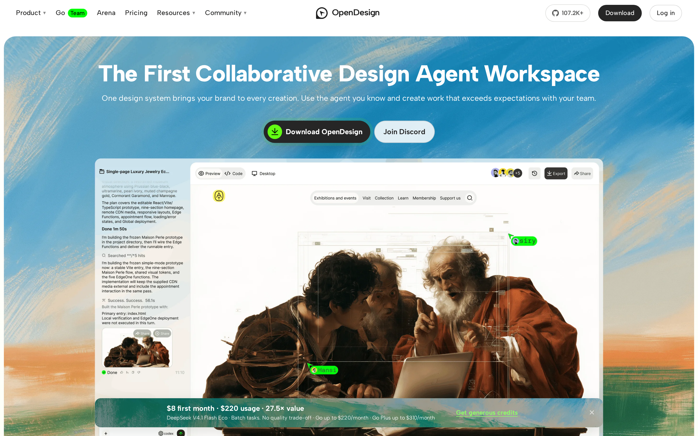
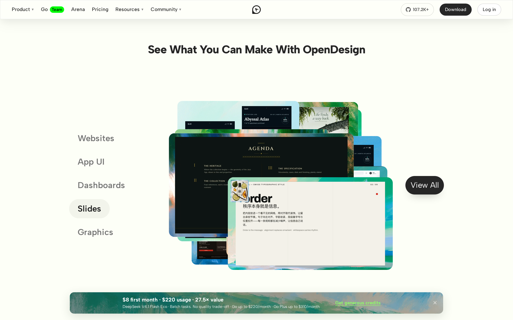
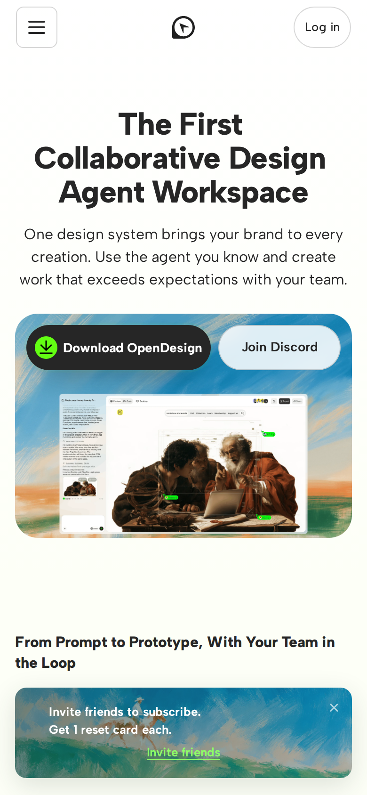

# Open Design signed-out page: first-impression craft

## Evaluation summary

The signed-out landing makes a strong first impression: the hero headline, short subhead, and two clear CTAs are immediately visible and readable on desktop and mobile. The page uses a consistent visual system (rounded screenshot cards, a painterly background, and large type) that ties modules together, but a persistent promotional bar and a very long, duplicated agent list add noise. Patterns worth borrowing: a dominant, scannable hero with a single clear primary CTA; generous type scale and rhythm that work across breakpoints; preloading the brand font to avoid layout shift. Anti-patterns to avoid: duplicating long lists of partners or agents in the same region; overlays that obscure key visuals or CTAs; small low-contrast text for secondary info that becomes hard to read on textured backgrounds.

## Evidence

- Target URL: https://open-design.ai/
- Canonical URL: https://open-design.ai/
- [Page text](screenshots/2026-W46_open-design-signed-out-page-first-impression-craft_43088237834_1/page-text.txt)
- [HTML snapshot](screenshots/2026-W46_open-design-signed-out-page-first-impression-craft_43088237834_1/page-content.html)

*Desktop viewport: above the fold.*

*Desktop viewport: full page.*

*Desktop viewport: mid-page.*

*Mobile viewport.*

## Craft review

This report establishes the comparable craft baseline once for this canonical page, capture context, and rubric.

Overall the page demonstrates high craft: clear hierarchy, careful typography, and a unified visual language. The hero leads with an unambiguous claim and an obvious primary action. Secondary content and some promotional UI add mild noise but do not break the core impression. This establishes a strong baseline for future comparisons.

| Dimension | Weight | Score | Weighted score | Rationale |
|---|---:|---:|---:|---|
| Visual hierarchy | 1x | 5 | 5 | The hero presents an unmistakable primary message and action within seconds: a large headline, concise subhead, and a dominant download CTA paired with a secondary Discord CTA, supported by a framed product image that anchors focus. |
| Information density | 1x | 4 | 4 | Above the fold is intentionally sparse and focused, but the page contains denser areas (a long, repeated list of supported agents and a promotional bar) that introduce noise without adding immediate value to first-time visitors. |
| Readability | 1x | 4 | 4 | Type scale, line length, and spacing make headings and body copy easy to scan on desktop and mobile; most contrast is sufficient, though textured background areas and some small secondary text reduce legibility in a few places. |
| Coherence | 2x | 4 | 8 | The site reads as a single designed product: shared rounded corners, brushstroke background motifs, and consistent button treatment create a cohesive identity, even though some modules (promos, repeated lists) feel like additives. |
| Durability | 1x | 4 | 4 | The layout and scale are modular and would tolerate moderate content changes; components and spacing suggest resilience, though heavy overlays or long unstructured lists could stress the visual balance if expanded. |
| Intentionality | 1x | 4 | 4 | Most design choices read as purposeful (prominent primary CTA, preloaded brand font, framed product visuals), but duplicated agent listings and the bottom promo bar feel opportunistic rather than thoughtfully integrated. |
| **Total** |  |  | **29/35** | **Comparable craft baseline.** |

### Human craft review

| Dimension | AI score | Human score | Notes |
|---|---:|---:|---|
| Visual hierarchy | 5/5 |  |  |
| Information density | 4/5 |  |  |
| Readability | 4/5 |  |  |
| Coherence (2x) | 4/5 |  |  |
| Durability | 4/5 |  |  |
| Intentionality | 4/5 |  |  |
| **Total** | **29/35** |  |  |

## Human verdict

Reviewed:

[ ] Confirmed / [ ] Needs revision

Record any scope exclusions explicitly. Confirmation applies only to the supplied human ratings or validation.

*Scoring model: gpt-5-mini*
*Status: auto-scored, pending human review*
